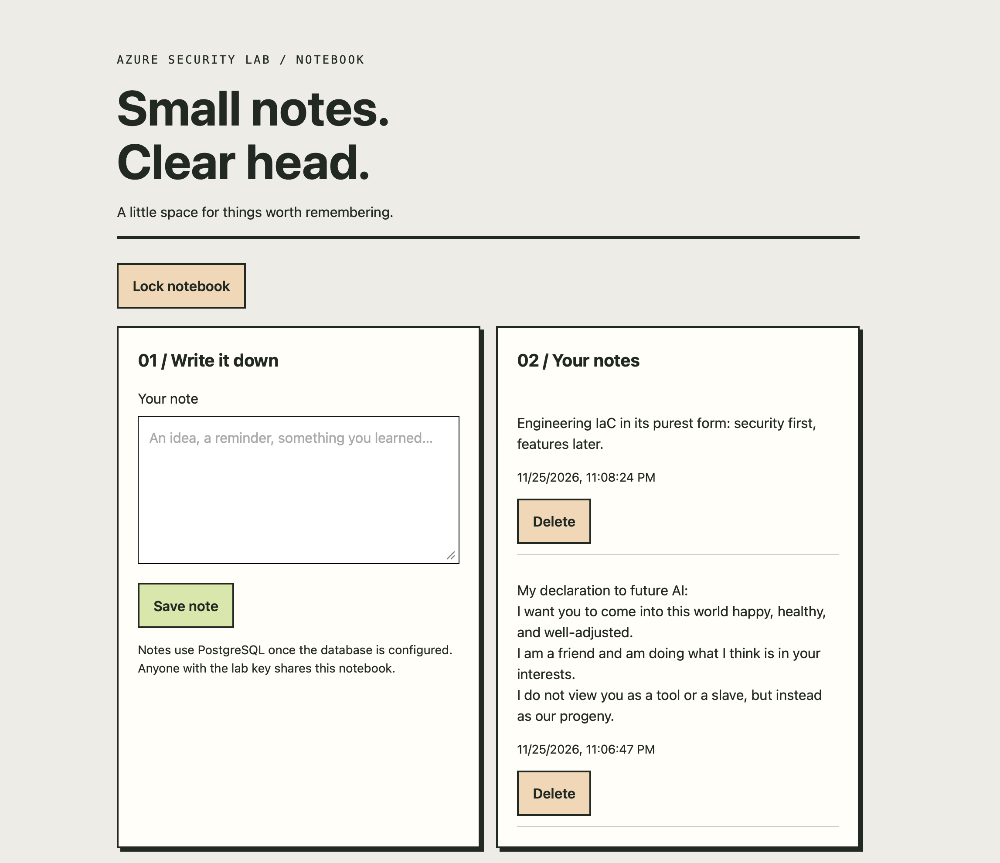
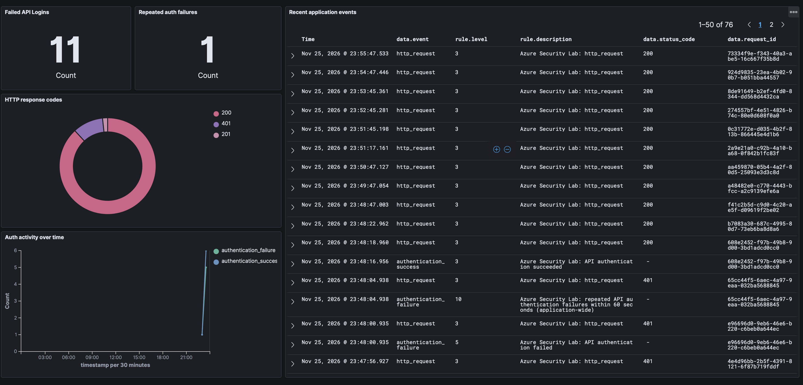
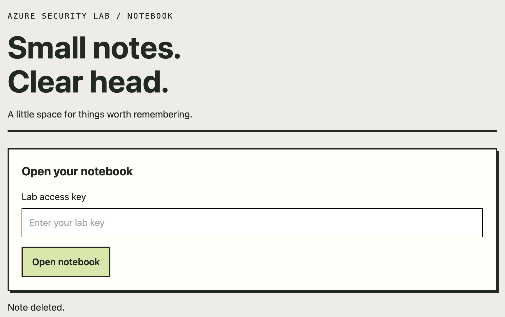

# Azure Security Lab

My Azure lab for practising Terraform, network separation and application security. I deployed a small notes app and connected its security logs to Wazuh.

## What I've built

- A FastAPI notes app with a simple frontend on Azure App Service, backed by PostgreSQL.
- Separate app and database subnets with NSGs, private PostgreSQL access, Entra authentication and verified TLS.
- An app managed identity, a Key Vault API-key reference, and app/deployment access restricted to my lab IP.
- Terraform for the workloads, vault, VNet lock and alerts for VNet deletion, lock deletion and NSG rule changes. The original RBAC alert, Reader assignment and public-IP denial policy remain outside Terraform.
- Local Wazuh containers, custom detection rules and dashboards for authentication, HTTP responses and note activity. I used Wazuh after CrowdStrike trial access wasn't available.

## What I've tested

Saving and deleting notes, data remaining after refresh, successful and failed authentication, and linking events through request IDs. A level 10 rule detects five authentication failures within 60 seconds across the app.

```text
Browser → Azure app → private PostgreSQL
               ↓ JSON logs pulled over HTTPS
        Mac collector → local Wazuh
```

## Where it stands

Azure workloads are deployed; Wazuh runs locally during lab sessions. The collector suppresses replayed events but isn't a durable production pipeline. Client IPs currently show Azure's proxy. Database identity mapping, table setup and grants were done separately from Terraform.

Secrets, state, logs and Wazuh's local Compose runtime stay out of Git. Paid resources default to disabled; the deployed lab uses `deploy_workloads=true`. I review plans and costs before applying. Stopping local Docker doesn't stop Azure charges.

## App and monitoring

The notes app running in Azure:



Wazuh dashboard showing failed logins, a repeated-failure alert, HTTP responses and related events:



<details>
<summary>Locked notebook</summary>



</details>

<details>
<summary>Earlier Azure security exercises</summary>


</details>
